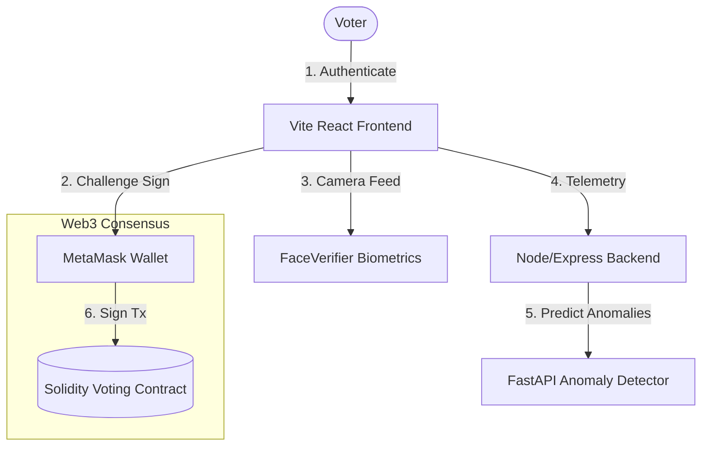
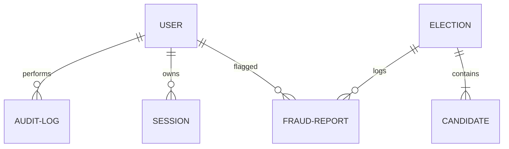
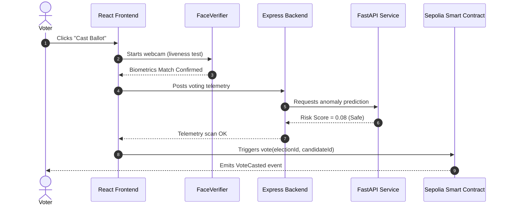

# B.Tech Capstone Project Report

## Project Title
**AI-Based Secure Voting DApp Using Blockchain, Smart Contracts, AI Fraud Detection, and Face Verification**

---

## 1. Abstract
The shift toward digital systems has highlighted vulnerabilities in traditional voting methodologies, such as paper ballot stuffing, unauthorized physical access, and central database manipulation. While electronic voting machines (EVMs) offer convenience, they lack public audibility and are susceptible to centralized software tampering. This project presents a decentralized, secure, and intelligent online voting platform. By combining the immutability of the Ethereum blockchain with real-time AI-based fraud detection (using Isolation Forest and Random Forest classifiers) and face verification biometrics, we establish a zero-trust voting framework. Votes are securely tallied by Solidity smart contracts, ensuring each voter casts exactly one ballot from a verified wallet, while client anomaly monitoring blocks automated voting bots.

---

## 2. Problem Statement
Existing online voting systems are plagued by:
1. **Centralized Trust Deficit**: System administrators or server hosters can modify database records undetected.
2. **Identity Impersonation**: Credentials can be stolen or purchased, allowing attackers to vote on behalf of legitimate users.
3. **Sybil Attacks and Botnets**: Automatic scripts can vote in rapid succession using multiple proxy IPs and wallet keys.
4. **Lack of Transparency**: Voters cannot independently verify if their votes were counted correctly without exposing ballot confidentiality.

---

## 3. Literature Survey & Gap Analysis
Traditional approaches to secure electronic voting rely on cryptographic voting protocols (such as blind signatures and homomorphic encryption). However, these architectures present limitations:

| Reference / System | Core Technology | Primary Limitation | SecureVoteAI Solution |
| :--- | :--- | :--- | :--- |
| **Helios Voting** | Homomorphic Encryption | Susceptible to credential sharing and client-side bot automated voting. | Adds biometric liveness check and AI anomaly scan. |
| **Estonian e-Voting** | Centralized HSM + Smart Cards | Lack of public audibility; rely on centralized trust. | Implements decentralized Sepolia Ethereum ledger. |
| **Polys (Kaspersky)** | Private Blockchain | Closed source; lack of real-time botnet tracking. | Open source API client telemetry scanning. |

---

## 4. Proposed Methodology & Architecture

Our system implements a hybrid Web2/Web3 architecture. 



### 4.1 Core Algorithms

#### AI Anomaly Risk Calculation
The FastAPI anomaly scanner scales incoming voter telemetry vector $X = [x_1, x_2, \dots, x_6]$ using `StandardScaler` and inputs it to:
1. **Isolation Forest** ($f_{IF}(X)$) -> Yielding anomaly score $S_{IF} \in [0, 1]$.
2. **Random Forest** ($f_{RF}(X)$) -> Yielding probability $P_{RF} \in [0, 1]$.

Combined Risk Score:
$$\text{Risk Score} = 0.4 \times S_{IF} + 0.6 \times P_{RF}$$
If $\text{Risk Score} > 0.5$, the transaction is flagged and manual audit logs are generated.

#### Solidity Vote Tallying
The smart contract stores voting states using a double mapping:
```solidity
mapping(uint256 => mapping(address => bool)) public voted;
```
Ensures $O(1)$ complexity for one-wallet-one-vote validation check:
```solidity
require(!voted[_electionId][msg.sender], "Already voted");
```

---

## 5. System Diagrams

### 5.1 Entity-Relationship (ER) Diagram


### 5.2 Use Case Diagram
```mermaid
leftToRightDirection
actor Voter
actor Admin
actor Officer
rectangle VotingSystem {
    Voter --> (Connect Wallet)
    Voter --> (Verify Biometrics)
    Voter --> (Cast Vote)
    Admin --> (Create Election)
    Admin --> (View AI Alerts)
    Officer --> (Add Candidate)
    Officer --> (Verify Results)
}
```

### 5.3 Sequence Diagram: Voting Pipeline


---

## 6. API Documentation

### 6.1 Authentication Endpoints
* **`POST /api/auth/register`**
  * Description: Register voter and trigger verification email.
  * Payload: `{ "name": "Sarah", "email": "sarah@edu.com", "password": "pass", "faceEmbedding": [...] }`
* **`POST /api/auth/verify-otp`**
  * Description: Validates 6-digit OTP code.
  * Payload: `{ "email": "sarah@edu.com", "otp": "123456" }`
* **`POST /api/auth/login-wallet`**
  * Description: Cryptographic MetaMask signature verification login.
  * Payload: `{ "walletAddress": "0x...", "challenge": "nonce...", "signature": "0x..." }`

### 6.2 Election & Candidate Endpoints
* **`POST /api/elections`** (Admin/Officer only)
  * Description: Schedule a new election.
* **`POST /api/candidates`** (Admin/Officer only)
  * Description: Add candidate profile.

---

## 7. Developer & Installation Guide

### Prerequisites
- Node.js (v20+)
- Python (v3.10+)
- MetaMask extension installed

### 1. Backend Setup
```bash
cd backend
npm install
cp .env.example .env
npm start
```

### 2. AI Service Setup
```bash
cd ai
pip install -r requirements.txt
python main.py
```

### 3. Frontend Setup
```bash
cd frontend
npm install
npm run dev
```

### 4. Smart Contract Compilation
```bash
cd blockchain
npm install
npx hardhat compile
```

---

## 8. Conclusion & Future Scope
The AI-Based Secure Voting DApp delivers a secure, auditable alternative to traditional digital voting applications. By enforcing decentralized ledger consensus, preventing botting via unsupervised ML classifiers, and checking biometric liveness constraints on client nodes, the framework addresses key vulnerabilities in remote digital democracy. 

Future iterations will incorporate **Zero-Knowledge Proofs (ZKPs)** to verify that a voter is authorized without storing any linkable address registry, achieving absolute ballot anonymity.
